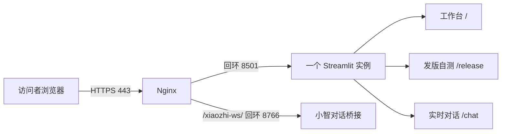

# 工作台、发版自测和实时对话统一部署方案

> 整理日期：2026-10-30。状态：方案已整理，服务器部署及真实验收尚未执行。
> 本文对应当前工作区功能；实际服务器系统、域名、安装目录及访问范围仍待公司环境确认。

## 1. 部署方式

只部署一套完整 Python 项目，启动一个 Streamlit 实例，同时提供三个入口，不分别部署三套应用。

| 页面 | 本地地址 | 服务器地址示例 |
|---|---|---|
| Agent 评测工作台 | `http://127.0.0.1:8501/` | `https://demo.example.com/` |
| 发版自测 | `http://127.0.0.1:8501/release` | `https://demo.example.com/release` |
| 玩具实时对话 | `http://127.0.0.1:8501/chat` | `https://demo.example.com/chat` |

域名 `demo.example.com` 是占位符，需要替换为公司实际域名。三个入口共用测试集、玩具配置、裁判配置、报告目录、后台任务管理和设备互斥。独立演示页面隐藏侧栏，不构成权限隔离。



小智桥接由应用按需启动，不需要手工再起一套工作台。其他四个玩具仍嵌入原有对话网页；访问者电脑也需要能访问对应外部网页及服务。

## 2. 到公司后先确认

- 服务器操作系统、架构、SSH 或远程登录权限、是否已有其他站点。
- 实际域名、DNS 修改权限、HTTPS 证书由谁维护、Nginx 是否已安装。
- 面向公司内网、VPN 还是外部访问；是否使用公司现有的统一认证或网关。
- 服务器能否访问公司玩具 OTA/WS、裁判接口和小智服务；访问者电脑能否访问原玩具对话网页。
- 仪宝等玩具实际配套的 Token、设备 MAC、客户端 ID。部署本身不能解决设备鉴权或 hello 握手失败。
- 需要迁移哪些测试集、工具定义、玩具档案及历史报告，数据备份放在哪里。

当前推荐方案为 Linux + Python 3.11 + systemd + Nginx + HTTPS。已有详细命令以 Debian 12 为例；若实际是其他 Linux 或 Windows Server，应先调整对应安装和服务管理步骤，不直接照搬。

## 3. 发布前整理当前版本

当前新增功能尚有未提交文件，仅拉取之前的 Git 提交可能缺少功能。先核对工作区，形成完整可追溯的发布版本，再上传服务器；不要上传本机虚拟环境或未经检查的整目录压缩包。

除原项目文件外，至少确认包含：

```text
streamlit_app.py
ui_release.py
run_progress.py
ui_jobs.py / ui_worker.py / ui_request.py
asset_store.py / dataset_thresholds.py
toy_management.py / toy_profiles.py / ui_catalogs.py
requirements.txt / pyproject.toml
templates/ / .streamlit/config.toml
data/ / settings/ / toys/
deploy/ / scripts/ / tests/
```

测试集 Excel 和对应 `.thresholds.json` 一起迁移，保留版本关联。新增玩具已默认声明五项能力；这不代表已经完成真实能力验证。

不将真实 API Key、Token、`.env` 等密钥文件、`.streamlit/secrets.toml`、`.runtime/credentials`、本机 `.venv`、临时锁和缓存打入源码发布包。所需报告单独按公司数据要求迁移。检查玩具 JSON 中的凭据引用，`local:…` 不能当作服务器可用凭据；Windows DPAPI 密文不能直接复制到 Linux 使用。

本方案按完整源码目录加 `pip install -r requirements.txt` 部署，不单独把当前项目构建为 wheel 安装。

## 4. 安装并启动

以下假设部署目录为 `/srv/toy-agent/app`，运行账户为 `toyagent`，已完成源码上传、账户创建及目录授权。首次安装命令、域名和证书配置详见[完整服务器部署手册](server_deployment_guide.md)。

```bash
cd /srv/toy-agent/app
python3.11 -m venv .venv
.venv/bin/python -m pip install -r requirements.txt
.venv/bin/python scripts/check_environment.py
.venv/bin/python -m pip check
```

以专用非 root 账户运行。账户需要写入 `data/`、`settings/`、`toys/`、`reports/`、`.runtime/` 及相应备份目录；不要使用 `chmod 777` 解决权限问题。

使用现有 [systemd 服务模板](../deploy/toy-agent.service.example)，其工作目录和虚拟环境路径应与实际安装一致。服务加载 `/etc/toy-agent.env`；部署人员在服务器本地编辑，权限设为 `600`。环境文件示例：

```ini
# 以下 Key 均为占位符，在服务器本地填写，不提交 Git。
DASHSCOPE_API_KEY=QWEN_KEY_PLACEHOLDER
DEEPSEEK_API_KEY=DEEPSEEK_KEY_PLACEHOLDER

XIAOZHI_CHAT_PUBLIC_ORIGIN=https://demo.example.com
XIAOZHI_CHAT_PORT=8766
STREAMLIT_BROWSER_SERVER_ADDRESS=demo.example.com
STREAMLIT_BROWSER_SERVER_PORT=443
STREAMLIT_SERVER_ENABLE_CORS=true
STREAMLIT_SERVER_ENABLE_XSRF_PROTECTION=true
```

systemd 环境文件不写 `export`。实际密钥必须替换占位符；修改后重启服务。裁判注册配置需引用这些变量：默认 Qwen 为 `DASHSCOPE_API_KEY`，DeepSeek 为 `DEEPSEEK_API_KEY`；自定义裁判按自己的 `credential_ref` 配置。独立 `/release` 不提供裁判 Key 输入，使用服务已配置凭据；工作台内的发版自测仍支持临时输入优先。玩具 Token 仍可每次手动输入；如需自动读取，迁移对应玩具的环境变量引用。

服务的实际启动方式为：

```bash
/srv/toy-agent/app/.venv/bin/python -m streamlit run streamlit_app.py \
  --server.address 127.0.0.1 \
  --server.port 8501 \
  --server.headless true \
  --server.fileWatcherType none
```

服务安装完成后检查：

```bash
sudo systemctl status toy-agent.service --no-pager
curl -fsS http://127.0.0.1:8501/_stcore/health
```

健康接口预期返回 `ok`。不要同时手动运行第二个 Streamlit 实例。

## 5. 域名、HTTPS 与反向代理

沿用 [Nginx 配置模板](../deploy/nginx-chat.conf.example)：

| 代理路径 | 内部目标 |
|---|---|
| `/`，包含 `/release`、`/chat`、资源及 Streamlit WS | `http://127.0.0.1:8501` |
| `/xiaozhi-ws/` | `http://127.0.0.1:8766/` |

三个页面不需要分别配置三个端口。保留 WebSocket 升级头及长连接超时，小智桥接保留原始 Origin 和路径前缀改写。8501、8766 只监听服务器回环，对外由 Nginx 提供 HTTPS。公共来源变量填写域名来源，不带 `/chat` 或 `/release`。

证书申请、DNS、Nginx 站点文件的完整命令见[部署手册第 6–9 节](server_deployment_guide.md)。公网浏览器录音需要 HTTPS 和麦克风授权。若限制演示对象，在部署入口使用公司已有访问控制，不以隐藏侧栏替代鉴权。

## 6. 上线验收清单

以下项目由部署人员填入实际证据，目前均为待服务器验收。

| 验收项 | 状态 |
|---|---|
| Python 3.11、锁定依赖和目录权限正确 | 待验收 |
| 单一 Streamlit 实例、systemd 服务与健康接口正常 | 待验收 |
| 域名、HTTPS、WebSocket 代理和访问控制正常 | 待验收 |
| `/` 的原菜单、用例维护和报告读取正常 | 待验收 |
| `/release` 可选玩具、测试集和裁判，不出现运行环境选项 | 待验收 |
| 独立入口读取服务器凭据且无 Key 输入框；工作台临时 Key 仍可使用 | 待验收 |
| 经明确授权运行少量真实用例，采集/评分进度、日志和结果正常 | 待验收 |
| 停止后显示已停止、设备占用释放、可以再次运行 | 待验收 |
| 完整报告在独立路由内打开、返回正常、Excel 可下载 | 待验收 |
| 新增用例后 Excel 与阈值文件同步保存 | 待验收 |
| `/chat` 各玩具页面及真实文本/语音可用 | 待验收 |
| 小智公共桥接 WS、hello、收音、播放、断开正常 | 待验收 |
| 原平台与独立入口的设备互斥生效 | 待验收 |

页面打开和健康检查不会自动运行评测；真实用例、付费裁判及设备对话要在明确的验收范围内操作。页面返回 HTTP 200 不等于协议握手、评分或音频功能验收通过。

本地回归可运行下列专项测试，均使用临时数据或本机模拟服务：

```bash
.venv/bin/python -m unittest discover -s tests -p test_release_route.py -v
.venv/bin/python -m unittest discover -s tests -p test_release_selftest.py -v
.venv/bin/python -m unittest discover -s tests -p test_stop_jobs.py -v
.venv/bin/python -m unittest discover -s tests -p test_case_threshold_sync.py -v
.venv/bin/python -m unittest discover -s tests -p test_live_chat_ui.py -v
.venv/bin/python -m unittest discover -s tests -p test_xiaozhi_chat.py -v
```

## 7. 日常更新、回滚与排障

更新前等待正在运行的评测和对话结束，备份代码版本、数据、配置、阈值文件及报告。用独立目录检查新版本，再在维护窗口更新代码和必要依赖；不要用整目录覆盖删除服务器新增的测试集与报告。

```bash
sudo systemctl restart toy-agent.service
sudo systemctl status toy-agent.service --no-pager
curl -fsS http://127.0.0.1:8501/_stcore/health
sudo journalctl -u toy-agent.service -n 100 --no-pager
sudo nginx -t
```

关闭文件监听后，上传源码不会自动生效，需重启服务。重启会中断现有进程和会话，也会丢失内存中的任务句柄；应提前停止任务，重启后刷新页面。历史报告继续保留。单靠历史 `running` 状态不能证明旧进程还在运行，不要手动猜 PID 来停止任务。

回滚恢复上一套匹配的代码、依赖与必要配置，再逐项验收三个入口；业务数据不能顺带覆盖成旧版本。Nginx 改动先 `nginx -t` 再 reload。

页面 502 优先检查服务和回环 8501；页面持续加载检查 Streamlit WS 升级代理；缺裁判凭据检查服务环境及模型的引用；hello 失败检查实际 Token/MAC/客户端 ID 与服务端协议。小智桥接在首次打开小智页后才监听 8766，具体排障见[实时对话部署说明](xiaozhi_chat_deployment.md)。

下一步：到公司确认第 2 节环境信息，再选择对应系统的安装步骤，执行部署并填写第 6 节验收记录。
