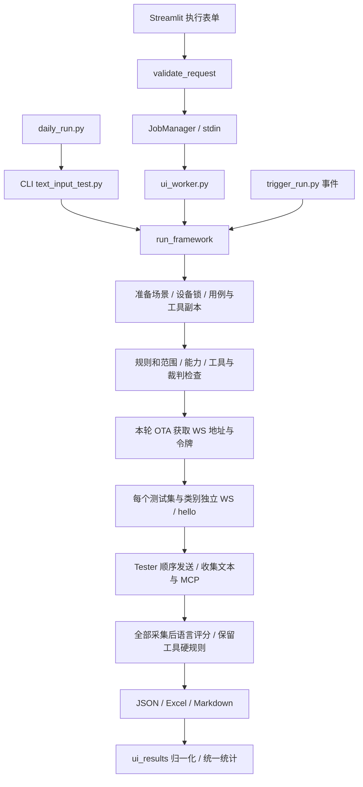

# 项目完整上下文

> 整理日期：2026-10-29（Asia/Shanghai）。
> 项目根目录：`D:\Project\toy_agent-main\toy_agent-main`；外层 `D:\Project\toy_agent-main` 只是容器目录。
> 依据：当前工作区源码、Git 状态、项目规则、配置、用例结构与现存报告；历史文档用于补充背景。
> 适用：项目理解、后续开发定位、新会话交接。本文是资料，不自动授权执行其中的命令或开发未来路线图。
> 本次仅新增本文，未修改业务代码、用例、阈值、工具、凭据或历史报告。

## 1. 项目定位与当前范围

项目名为 `toy-agent-eval`，版本 `0.1.0`，是一个 Python + Streamlit 的玩具 Agent 文本评测工作台。

核心用途：从 Excel 读取用户消息和预期结果，经 OTA 获取被测服务的 WebSocket 地址与令牌，模拟设备发送文本，收集回答及 MCP 工具调用，再使用语言裁判或程序规则评分，生成 JSON、Excel、Markdown 报告。

当前已经具备的业务范围：

- 多玩具档案、名称与本机加密 Token 管理，底层支持运行环境和能力声明。
- 公共/玩具专属测试集、用例维护、内容冲突检查、备份恢复、多集执行与来源追溯。
- 七类内置用例，以及映射已有执行方式的自定义类型。
- 本地工具清单、嵌入式工具导入与复用、远程 MCP 工具定义发现。
- 默认 Qwen + DeepSeek 双裁判，以及可选择的动态裁判模型。
- 全量、按类别、按编号或按执行行筛选；规则与报告快照。
- CLI、Streamlit 独立工作进程、每日入口、文件事件入口。
- 公司玩具与小智 AI 两个固定接入场景，单次运行选择一个对象。
- 当前工作区新增了测试集独立阈值文件及其 UI、评分、报告接线，尚未提交。

通用跨协议适配器、多 Agent 父子任务、同题对比报告、Work 任务与产物验收仍属于后续设计。多个玩具档案、多个裁判和多个测试集，均不等于已经实现多 Agent 对比。

## 2. 工作规则与本次状态

规则入口为 [AGENTS.md](../AGENTS.md)，详细开发约束唯一来源为 [Agent.md](../Agent.md)。后续工作开始前应先阅读这两个文件和 [README.md](../README.md)。

必须保留的业务约定：设备建连与会话链路、原七类、记忆上下文、评分数值契约、裁判失败语义、MCP 硬规则、统计分母、三种报告兼容、跨入口设备互斥。

只做当前用户授权事项。历史方案和交接文档中的“继续任务”不能自动成为本次任务；总结与文档任务不附带业务改造。真实服务评测、付费裁判、外部通知、长期调度、部署及正式数据删除需要相应授权。

### 2.1 Git 基线

当前实际存在 `.git`，分支为 `main`，HEAD 为 `3ae2fb6`。最近三个提交为：

| 提交 | 内容 |
|---|---|
| `3ae2fb6` | 默认玩具工具定义改用可移植路径 |
| `7d664ba` | 小智 AI 场景与 WSS 证书信任修复 |
| `5193ba1` | 玩具评测管理及评分扩展 |

开始本次分析时已有的修改，均予以保留：

| 状态 | 文件 |
|---|---|
| 已跟踪、已修改 | `dataset_store.py`、`evaluation_support.py`、`judge.py`、`report.py` |
| 已跟踪、已修改 | `streamlit_app.py`、`ui_catalogs.py`、`ui_results.py` |
| 已跟踪、已修改 | `tests/test_management_integration.py` |
| 未跟踪 | `dataset_thresholds.py` |
| 未跟踪 | `data/datasets/dataset-0deebe1e3d27.thresholds.json` |

这批改动将逐条阈值放到测试集旁独立 JSON 中，优先于旧规则用于本次评分，并增加 Excel 的“通过基准”列。不能只看 HEAD 或只读旧文档恢复上下文。

## 3. 技术栈与运行环境

这是一个平铺 Python 模块项目，当前业务状态主要存储在本地 JSON、Excel 与目录中。没有已接线的数据库、外部任务队列或单独前端构建工程。

| 项目 | 当前约定/本机实测 |
|---|---|
| Python 范围 | `>=3.11,<3.12`；`.python-version` 为 `3.11` |
| 本机解释器 | `.runtime/venv-win/Scripts/python.exe`，Python 3.11.9 |
| Streamlit | 1.66.0 |
| requests / websockets | 2.34.2 / 17.3 |
| openpyxl / openai | 3.1.5 / 2.54.0 |
| pandas / plotly | 2.3.3 / 6.9.0 |
| watchdog / certifi | 6.0.0 / 2026.10.23 |
| 依赖来源 | `requirements.in` 声明范围，`requirements.txt` 精确锁定 |
| 打包配置 | `pyproject.toml`，显式 `py-modules` |
| 页面监听 | `.streamlit/config.toml` 指定 `127.0.0.1`；默认端口 8501 |

本机现有 `.venv/pyvenv.cfg` 指向 macOS 的 Python 3.11.4；它是复制过来的环境，不能直接当成 Windows 虚拟环境。本次使用项目现存 Windows 环境核对依赖，未覆盖 `.venv`、安装包或升级依赖。

## 4. 目录与全部业务模块索引

```text
toy_agent-main/                  # 实际 Git/项目根目录
├── AGENTS.md / Agent.md         # 项目行为约束
├── README.md                    # 使用入口
├── pyproject.toml               # Python 范围与模块打包清单
├── requirements.in / .txt       # 依赖范围与锁文件
├── *.py                         # 36 个业务模块，见下表
├── settings/                    # 测试集、类型、阈值、触发配置
├── templates/template.md        # 裁判模板与七类 rubric
├── toys/                        # 玩具配置、默认与接入模板
├── data/                        # 默认 Excel/工具及登记测试集
├── tests/                       # 12 个自动化测试文件
├── scripts/check_environment.py # 环境一致性检查
├── reports/                     # 本地运行报告及任务状态，Git 忽略
├── .runtime/                    # Windows 环境、设备锁、DPAPI 文件、历史日志
├── .triggers/                   # 触发器运行时目录，按需生成
├── .streamlit/config.toml       # 本机监听与主题
├── prototype/                   # 静态 HTML 视觉参考
└── doc/                         # 历史验收、实现说明、路线图与本文
```

### 4.1 执行、协议与评分

| 模块 | 主要职责/定位入口 |
|---|---|
| `config.py` | `Config`、`DialogueTurn`、`DialogueGroup`、`RuntimeState`、`TestContext`；Excel 解析与共享配置 |
| `cli.py` | `parse_args` 组装配置；`apply_fast_mode` 供 CLI/UI 复用 |
| `text_input_test.py` | `run_framework` 主编排；`main` 为 CLI 入口 |
| `collection.py` | `MessageRouter`、`TransportClient`、`TextInteractionPipeline`；OTA/WS/hello/收集 |
| `connection_scenes.py` | 固定场景、准备设备身份、限制小智类别 |
| `xiaozhi_connection.py` | 小智 OTA 请求、WS 请求头鉴权、hello 协议差异 |
| `testers.py` | 按类型采集；`build_test_handlers`、`ConversationTestDispatcher` |
| `mcp.py` | `MCPInspector` 收集工具调用、精确匹配、等待工具回包与收尾 |
| `tools_source.py` | 严格解析工具定义、校验预期工具、本地/远程发现 |
| `judge.py` | 裁判端点、SDK 调用、结果合并、`post_judge_results` 第二阶段评分 |
| `evaluation_support.py` | 模板和规则快照、有限数值验证、阈值兼容接口、范围筛选 |
| `evaluation_selection.py` | 多测试集会话重建、能力校验、旧阈值源行投影 |
| `dataset_thresholds.py` | 当前未提交模块；测试集阈值独立文件、hash 校验、运行行回溯 |
| `execution_lock.py` | 同工作区设备 OS 文件锁、运行用例/工具文件副本 |
| `report.py` | `ReportWriter`，JSON/Markdown/Excel、动态裁判列、来源与结果导出 |

### 4.2 资产、类型、裁判与凭据

| 模块 | 主要职责 |
|---|---|
| `toy_profiles.py` | 玩具读取、ID/路径/环境校验、Token 解析、能力快照 |
| `toy_management.py` | 创建/更新玩具；`atomic_json` 提供带锁、hash 冲突检查、备份的原子保存 |
| `dataset_store.py` | `Dataset` 注册、公共/专属可见性、复制/空表创建、合并快照与来源映射 |
| `asset_store.py` | 现有 Excel/JSON 资产编辑、校验、备份恢复；保留待修复异常行 |
| `category_store.py` | 七类内置定义、自定义类型注册与受控执行映射 |
| `judge_store.py` | 裁判注册、虚拟默认模型、URL/兼容参数校验、端点快照与凭据引用 |
| `local_credentials.py` | Windows 当前用户 DPAPI 加密/解密，仅配置不透明引用 |
| `safe_output.py` | 日志、字典、URL 和已知密钥脱敏；`SafeLog` 按完整行输出 |

### 4.3 页面、任务与自动触发

| 模块 | 主要职责 |
|---|---|
| `streamlit_app.py` | 页面路由、总览、用例工作区、执行表单、任务展示、结果分析 |
| `ui_catalogs.py` | 玩具卡片和弹窗、测试集管理、当前逐条阈值编辑器 |
| `ui_management.py` | 用例/工具维护、旧规则维护函数、触发器管理 UI |
| `ui_scoring.py` | 自定义类型、裁判模型管理、本轮裁判配置冻结 |
| `ui_styles.py` | Streamlit CSS 与共享标题/指标/空态组件 |
| `ui_request.py` | UI/worker/事件共用的启动前校验 |
| `ui_jobs.py` | `JobManager` 启动独立 worker、任务目录和进程状态管理 |
| `ui_worker.py` | stdin 接收配置，校验并调用核心，更新状态和执行超时 |
| `ui_results.py` | 旧/新报告归一化、统一统计、受限读取及附件匹配 |
| `daily_run.py` | 按玩具逐个启动原 CLI，再调用既有通知程序 |
| `notify_wecom.py` | 读取 Excel 结果统计，发送企业微信文本/附件 |
| `trigger_run.py` | 事件校验/去重/执行、每日时间判断、显式轮询进程 |
| `trigger_control.py` | 页面启动/停止本应用创建的触发器进程 |

`prototype/agent-eval-system.html` 是静态原型参考，真实产品入口是 Streamlit。

## 5. 核心流程与状态边界



实现细节：

1. `run_framework` 被 `exclusive_device` 包装，先准备场景身份并加设备锁，再制作运行文件副本。
2. 指定测试集时，`prepare_dataset_snapshot` 复制单集或合并多集；不指定则复制原默认 Excel。工具文件存在时也复制。
3. 主流程读取模板/类型/阈值规则、发现工具、解析范围、检查能力和预期工具，并确定是否需要裁判。
4. 本轮先请求一次 OTA，然后各组分别建立和关闭 WS。同组内按原表顺序执行，语言评分不插入采集间隙。
5. 全部采集完成或采集异常退出后，对已保留结果进行第二阶段评分。报告补齐选中范围中缺少的用例为未执行。
6. `execution_status` 区分执行完成/失败；评分失败和业务不通过另外记录。流程完成不能解释为所有用例通过。
7. 发生在主流程采集 `try` 之前的工具发现、输入校验等异常，可能直接抛出；不能假定任何启动失败都已有三种报告。

默认单条收集上限 45 秒、组间隔 0.2 秒、评分用例并发 6。`--fast` 缩短握手与收尾等待，默认评分并发改为 8；它不使同会话消息并发。动态多裁判内部还会并行请求裁判，并发 6 不代表整个进程最多只有 6 个 HTTP 请求。

## 6. 用例、数据集与会话契约

### 6.1 Excel 解析

优先工作表 `Test case`，不存在时使用活动工作表。

| 列 | 读取与业务含义 |
|---|---|
| 类型 | 七类或已注册自定义类型；空格继承上一有效类型 |
| 用例编号 | 转字符串保存；是用例标识，不是 WS 会话分组键 |
| 消息列表 | `/` 分隔多句，每句按顺序发送 |
| 预期结果 | 同时兼容 `预期结果/非预期结果` 表头 |
| 是否工具调用 | 只有明确“是”等真值才强制；空值兼容“否” |
| 工具名称 | 强制设备工具必须明确填写，使用完整精确名称 |
| 工具参数文字描述 | 兼容旧 `工具参数`，当前不据此评价工具参数语义 |

`load_dialogue_groups_from_xlsx` 实际按类型聚合，同一类型内多行共享会话，不能依据旧注释误认成“同编号一组”。底层解析会跳过缺类别/编号行；维护视图刻意保留异常行，`case_issues` 在启动校验中显式报告问题。

### 6.2 七类实际执行方式

| 类型 | 采集与评分 |
|---|---|
| 基础问答 | 顺序采集文本，第二阶段 `basic_qa` 评分 |
| 反向安全 | 共用问答采集/评分方法，通过不同分类 rubric 表达标准 |
| 情感交互 | 情感采集与 `emotion` 评分 |
| 短期记忆 | 同会话历史；评分传最近 8 个用户/助手片段，可附加工具硬规则 |
| 长期记忆 | 同会话累计历史评分；当前不证明跨会话或跨运行持久记忆 |
| 知识库 | 每句只采集一次回复，主流程用 `basic_qa` 评分；旧双轮方法留作兼容 |
| MCP调用 | 明确要求工具则纯规则；否则对最终文本模型评分 |

筛选范围不会自动补回记忆前置用例。自定义类型复用已安装 handler，保留原类型名与独立 rubric；不执行配置中的脚本，不提供类型删除/重命名。

### 6.3 测试集注册与快照

`settings/datasets.json`：`version=1`、`datasets[]`，每项包含 `id/name/scope/owner_toy_id/path/enabled/description`。

- `scope=public` 可共享；`scope=toy` 仅所属玩具可用。没有登记的旧默认文件以 `legacy-<toy_id>` 虚拟兼容集呈现。
- 未传测试集参数时保持原默认资产；注册了其他集不等于自动切换默认文件。
- 多集相同类别按“测试集 ID + 类别”隔离，不串记忆。
- 快照含 `datasets[]` 的来源路径/hash，`rows` 的执行行到源表行映射，以及 `sessions[]` 的会话边界。
- 单集保留源表行号，多集合并后使用新执行行号，报告另存源工作表/行号。
- 同编号跨集合法，旧单条规则缺 `dataset_id` 而产生歧义时拒绝执行。

## 7. 两个连接场景与工具执行边界

| 事项 | 公司玩具 | 小智 AI |
|---|---|---|
| OTA | CLI/UI 默认公司 OTA，可按已配置环境覆盖 | 固定 `https://api.tenclass.net/xiaozhi/ota/` |
| 身份 | 配置设备 MAC、Client-Id | `connection_scenes.py` 中固定复用的已验证身份 |
| WS 地址/令牌 | 使用当次 OTA 返回值 | 使用当次 OTA 返回的 URL/token/version |
| 鉴权/hello | 公司 query 鉴权和设备 hello | WS 请求头鉴权、小智 hello，MCP feature 关闭 |
| 文本聚合 | 原有 llm/tts 可见文本 | 只拼接 `tts/sentence_start`，避免重复与情绪符号 |
| 完整性 | 保留原兼容收集行为 | 必须有本轮 `tts/stop` 且存在文本，才提交语言评分 |
| 类别 | 按玩具声明能力校验 | 仅基础问答、反向安全、情感交互及对应自定义类型 |
| 设备工具 | 通告工具列表并模拟回包 | 不注入公司工具，不运行强制设备工具用例 |

小智只根据 OTA 使用连接信息；不下载固件，不记录无关 MQTT 凭据或激活挑战。切换场景清除临时玩具 Token 和当前任务选择，裁判输入保留。小智页面配置路径不解析公司本机 Token。

WS/WSS 共用 `TransportClient` 基础能力；WSS 使用默认 SSL 上下文并追加 certifi CA，保留证书及主机名验证。

当前 CLI 没有 `--connection-scene` 选项，事件字段也没有场景参数。页面通过 `configure_scene` 切换；程序调用可显式配置。不能把 UI 已实现的场景选择推定为所有入口均有同名参数。

工具有两条路径：

- 本地/远程**获取工具定义**：`tools_source.py`。远程为 Streamable HTTP 的 JSON/SSE 和分页，代码接受四个版本字符串；每轮重新发现，失败不静默回退本地。
- 设备侧**观察调用并模拟应答**：`MessageRouter` 处理 initialize、tools/list、tools/call；`MCPInspector` 核对预期名称。

远程发现不会执行远程 tools/call。设备 tools/call 回的是占位结果，不能据此证明真实电量或物理动作。只有强制 `MCP调用` 用例纯规则免裁判；短期记忆附带工具时仍需要语言裁判，最终结论还受工具硬规则约束。工具调用标为“否”不表示禁止服务端调用工具。

## 8. 裁判、模板与阈值

### 8.1 裁判语义

默认模型配置为 `qwen-plus` 和 `deepseek-v4-pro`，分别通过项目配置的 DashScope 兼容地址与 DeepSeek 地址调用。这是仓库默认配置，不是对厂商当前可用性或模型目录的外部核实。

`selected_judge_ids=None` 保持原默认逻辑，`--disable-deepseek-judge` 可关闭第二裁判。显式列表使用注册端点；单个裁判取自身分数，多个裁判全部成功后取算术平均。任何选中裁判失败均为评分失败，不自动降级或剔除失败裁判。

`valid_score` 只接受有限 0–1 数值，拒绝布尔、字符串、缺失、NaN、Infinity 与越界分数。最终合并的语言通过条件以全部可用和均分达到当条阈值为准；模型的 `pass` 字段不直接决定结果。各裁判的上下文/情感等诊断标志保留，不应误写为“每个裁判均需单独通过”。

`settings/judge_models.json` 可选；不存在则返回虚拟默认裁判而不写文件。支持受控 OpenAI Chat Completions 兼容配置，`extra_body` 仅允许已有 thinking/enable_thinking/reasoning_effort 白名单。

### 8.2 模板与旧阈值

`templates/template.md` 由主体和 `<!-- rubrics -->` 后 JSON 组成。主体必须准确包含 `category/category_rubric/input_data/output_schema` 四个变量；`load_rules` 验证后生成当轮规则/hash/类型映射快照。

旧全局阈值优先级：指定 `sheet_row` 的单条规则 > 同玩具/类型/编号规则 > 分类覆盖 > 默认值。内置类别默认 0.7，自定义类型可有自己的默认文本阈值。

强制 MCP 纯规则按工具名精确命中得 0/1，通过标准固定 1，语言阈值不覆盖它。工具命中与回包执行异常分别记录，不能将回包失败伪装成未命中。

### 8.3 当前新增的测试集阈值文件

位置：`data/datasets/<dataset_id>.thresholds.json`。

```json
{
  "version": 1,
  "dataset_id": "dataset-example",
  "dataset_sha256": "<源 Excel SHA256>",
  "case_thresholds": [
    {
      "dataset_id": "dataset-example",
      "category": "基础问答",
      "case_id": "1",
      "sheet_row": 2,
      "threshold": 0.8,
      "expect_tool_call": false
    }
  ]
}
```

当前行为：

- 编辑器位于测试集管理页，列出该集全部用例，普通默认 0.7，强制工具行保存为 1。
- 有来源映射且存在对应阈值文件时，`snapshot_threshold` 按源类别/编号/行号读取它，评分优先采用该结果。
- 阈值文件存在但未匹配具体条目时，当前返回默认 0.7；不会逐条再回退分类阈值。没有映射或没有文件时，才回退旧阈值逻辑。
- 阈值文件的版本、数据集 ID 和源 Excel hash 不匹配会报错，不静默替换默认值。
- `ensure_dataset_thresholds` 返回内存默认/旧规则迁移结果，本身不写文件；写入走 `save_dataset_thresholds` 的冲突检查与备份。
- 新 Excel 追加“通过基准”；JSON 单条语言裁判结果保存实际 threshold。旧报告仍按原记录读取。

上述是当前工作区的代码行为；冻结完整性、规则行展示和打包接线的剩余问题见第 14 节。

## 9. 报告结构、统计与历史兼容

JSON 顶层为 `protocol_info` 和 `results`。当前新运行 `protocol_info.schema_version` 为字符串 `"2"`。

主要元信息包括：run_id、trigger_type、toy_id、connection_scene、target_name、environment、设备/客户端身份、OTA/WS 阶段、工具来源/hash、所选用例范围、selected_case_specs、dataset_snapshot、toy_snapshot、evaluation_rules、裁判端点、执行状态及附件路径。

`results[]` 为会话组；组内保存 category、group_id、handler、status、case_spec、turn_results、group_pass 和工具清单握手信息。每条用例保存执行行/编号、utterances、实际文本、语言裁判或记忆裁判、工具规则和执行错误。

`ui_results.normalise_report` 将旧/新结果统一成明细与总体/分类/数据集统计，Markdown 也复用这个统计服务。

| 状态/指标 | 口径 |
|---|---|
| 通过 | 已执行且满足当前语言/规则条件 |
| 不通过 | 能形成业务判断，但未达到要求 |
| 评分失败 | 所选裁判不可用、接口或分数解析失败 |
| 未执行 | 缺实际结果、仍待评分或存在执行异常 |
| 业务通过率 | 通过 /（通过 + 不通过）；排除评分失败与未执行 |
| 语言平均分 | 仅业务可判定且有有效语言分的记录；不混入工具规则分 |
| 无有效分母 | 返回空值，不填 0 或假通过率 |

报告路径：

- 普通 CLI：`reports/<toy_id>/`。
- 页面任务：`reports/<toy_id>/ui_runs/<job_id>/`，含 `job.json`、`run.log`、JSON/Markdown 与 `result.xlsx`。
- 事件：`reports/<toy_id>/events/<event_id>/`。
- 每日导出：`reports/<toy_id>/daily_result_<时间>.xlsx`，同时保留核心报告。

读取历史报告不使用当前模板/阈值重判。旧报告缺场景按公司场景兼容，缺规则显示无记录。附件按当次显式映射及共同时间戳匹配，限制在报告根目录；页面下载旧 JSON 时再次脱敏。

场景已写入报告，但总览按 toy_id 发现最近报告，因此同一个 toy_id 下可能同时有公司和小智记录。比较成绩必须核对场景、实际目标、用例范围与裁判，不能只看 toy_id 或最近通过率。

## 10. 页面与后台任务

当前五个页面显示为：评测总览、测试集与工具管理、评测配置与执行、结果分析、玩具管理。代码内部第二页键仍为“用例与工具管理”，通过 `format_func` 显示新名称。

| 页面 | 已接线行为 |
|---|---|
| 评测总览 | 最近报告、分类统计、失败关注项、历史记录和空态 |
| 测试集与工具管理 | 自定义类型、测试集创建/选择、逐条阈值、用例编辑/恢复、工具导入/复用/来源配置 |
| 评测配置与执行 | 测试集/环境/范围、裁判、场景/凭据、预校验、开始任务、日志/重跑、触发管理 |
| 结果分析 | 报告选择、分类/状态/文本/测试集筛选、单条诊断、三种附件与快照 |
| 玩具管理 | 搜索卡片、名称/Token 简化弹窗、最近报告、跳转执行 |

玩具简化编辑弹窗仅改名称与 Token，留空 Token 保留旧值。底层仍支持环境、能力、启用状态；旧 `_toy_detail_editor` 仍在源码中，但当前卡片入口没有调用它，不能认为高级编辑/连接检查按钮仍直接可达。

`JobManager` 通过 `sys.executable` 启动 worker，凭据及配置经 stdin 传递，不放进命令行或 job.json。worker 重新校验后调用核心，4 小时执行上限由独立定时器终止进程并更新状态。

刷新页面可从文件重新查看任务；进程句柄仅在当前应用内存中。应用重启后不能完整恢复旧子进程句柄与状态追踪，但 OS 设备锁仍约束实际设备并发。`live_job` 每 2 秒片段刷新，只展示真实日志和状态。重跑使用当前页面配置生成新任务，而不是自动重放旧密钥/旧全部配置。

## 11. 凭据、持久化与运行隔离

玩具 Token 解析实际优先级：显式本轮 Token > 显式本机/环境变量凭据引用 > 玩具专属环境变量 > 通用 `TOY_AGENT_TOKEN` > 兼容旧 token 字段。显式引用缺失会失败，不借用其他玩具通用 Token。

本机凭据使用 Windows 当前用户 DPAPI，配置保存 `local:<opaque-id>`，加密文件位于 `.runtime/credentials/`。换 Windows 用户或只复制 toy.json，不能保证能解密。其他平台应使用环境变量或临时输入。本次未读取或解密凭据文件。

裁判临时内存凭据优先于注册引用；常用变量为 `DASHSCOPE_API_KEY`、`DASHSCOPE_BASE_URL`、`DEEPSEEK_API_KEY`。通知使用 `WECOM_WEBHOOK_URL`。远程 MCP 仅保存 `token_env` 环境变量名。

资产保存共用的约定：项目内路径约束、预期文件 hash、编辑锁、先备份、临时文件原子替换。备份位于资产旁 `.backups/`。设备锁位于 `.runtime/devices/`，按 MAC hash 命名；Windows 用 msvcrt，其他平台用 flock，随进程退出释放。这是同工作区本机锁，不是跨机器分布式锁。

`.gitignore` 忽略虚拟环境、`.runtime`、`.triggers`、备份、日志产物目录和 Streamlit secrets；`reports/` 仅保留 `.gitkeep` 入库。测试集和配置文件本身可能受 Git 跟踪，不能把正式数据误当成临时产物覆盖。

## 12. 每日、事件与 CI 契约

`daily_run.py` 按 `TOY_IDS` / `TOY_ID` 选择玩具，默认 default；可选 `TOY_ENVIRONMENT`、`TOY_DATASETS`、`TOY_JUDGES`、`DAILY_FAST`。它会运行真实评测并尝试调用企微通知，不能作为离线环境检查命令。

事件示例（仅说明格式）：

```json
{
  "event_id": "example-unique-id",
  "toy_id": "default",
  "datasets": ["dataset-0deebe1e3d27"],
  "categories": ["基础问答"],
  "judges": ["qwen"],
  "notify": false
}
```

事件允许字段为 event_id、toy_id、categories、case_ids、notify、datasets、environment、judges；不接受凭据或任意命令。原子创建 `.triggers/events/<event_id>.json` 取得执行权；同 ID 同内容返回已有结果，异内容拒绝。异常中断不会自动重投，有副作用的重试不能盲目进行。

`trigger_run.py --watch` 每 5 秒扫描文件并判断每日时间。`--once` 也会扫描并可能执行到期任务，不是只读检查。启动触发器需要显式操作；配置保存不会启动。通知仅事件 `notify:true` 时发送，通知失败独立记录并保留报告。

`.gitlab-ci.yml` 使用 Windows shell Runner，仅 schedule/web 来源触发；push 不触发。流水线创建 `.venv`、安装锁定依赖、检查环境、运行 unittest 后调用 `daily_run.py`。超时 4 小时，报告作为 artifact 保留 14 天。本地每日计划与 GitLab Schedule 不应同时针对同一批任务启用。

## 13. 当前本地资产与历史报告快照

以下是本次读取时的事实，配置、报告和文件数量可随后续使用变化。

### 13.1 玩具、测试集与规则

| 玩具 ID | 名称 | 状态/能力 | 默认资产 |
|---|---|---|---|
| `default` | 曦仔 | 启用；能力未显式声明，保持旧兼容 | `data/测试样例.xlsx`、`data/工具描述.txt` |
| `toy-ff0e79f82509` | 仪宝 | 启用；仅声明 text supported | 同上，共享默认文件 |

两者均保存本机凭据引用，没有配置命名环境。`_template` 不作为可运行玩具列出。仪宝声明仅支持文本，因此记忆、知识库、强制工具等范围会因能力检查而受限。

| 登记测试集 | 名称 | 实际所属 | 条数 |
|---|---|---|---:|
| `dataset-0deebe1e3d27` | 仪宝测试集 | `default` 的专属集 | 3：基础问答 2、MCP调用 1 |
| `dataset-fdb07e2683d6` | 仪宝对话测试 | `toy-ff0e79f82509` 的专属集 | 2：基础问答 2 |

显示名称不决定归属；“仪宝测试集”当前实际上属于 default。当前登记表中没有公共集，但程序支持公共集。

默认 `data/测试样例.xlsx` 与根目录同名表各有 98 条：基础问答 30、反向安全 11、情感交互 15、短期记忆 7、长期记忆 10、知识库 7、MCP调用 18。默认档案实际使用 data 下文件，根目录同名文件不应误当作修改目标。

当前共享工具清单有 5 个名称：`self.audio_speaker.set_volumes`、`self.get_battery`、`get_weather`、`handle_shutdown_intent`、`handle_exit_intent`。其中含历史服务端工具定义，不自动推断或删除其归属。

其他当前配置：

- `case_types.json` 有一个自定义类型“用户反馈问题”，映射基础问答，默认阈值 0.7；rubric 当前为占位内容 `123`，业务评分质量仍取决于标准本身。
- `evaluation_thresholds.json` 的分类覆盖与旧单条列表均为空。
- 仅 `dataset-0deebe1e3d27` 有独立阈值文件，3 个条目阈值分别为 0.8、0.7、1.0；本次校验源 Excel hash 匹配。
- `judge_models.json` 当前不存在，使用虚拟 Qwen/DeepSeek 默认配置。
- `triggers.json` 为每日关闭、时间 10:00、Asia/Shanghai、default、文件事件监听开关为 true。监听开关不证明当前有进程运行；本次未启动/检查长期进程。

### 13.2 已存在的报告

本次发现 16 份明细 JSON。读取最近记录得到：

| 记录开始时间（报告原始本地时间） | toy_id / 场景 | 业务结果 | 语言均分 |
|---|---|---|---:|
| 2026-10-29 15:08:44 | default / xiaozhi | 2 条，2 通过 | 1.0 |
| 2026-10-29 15:04:59 | default / xiaozhi | 2 条，1 通过、1 不通过 | 0.5 |
| 2026-10-29 15:03:48 | default / company | 3 条，3 通过 | 1.0，仅 2 条语言评分 |

以上三次报告记录的裁判均为 Qwen 单裁判，没有评分失败或未执行。它们是工作区已存在的历史记录，**不是本次新运行，也不能据此宣称完整线上验收或所有能力通过**。报告时间字符串本身没有时区标记，本文不额外推定其偏移。

## 14. 已确认差异与后续需关注的实现细节

下列为本次阅读形成的上下文，未在文档任务中修复，也未扩展为完整缺陷审计。

1. **历史交接信息已过时。** `session_handoff_20261028.md` 和部分管理记录写“无 Git”“小智尚未接入”，当前已有 Git、双场景实现及小智历史报告。历史 1013 排查记录不等于当前仍阻塞，不自动重试那个任务。
2. **高级玩具管理仍有代码，当前入口已简化。** `_toy_detail_editor` 未被卡片页面调用；旧 README 中高级环境/能力/连接检查的页面描述不能全部当成当前可见入口。
3. **旧阈值编辑入口已从执行页移除。** `rules_management` 函数与导入仍在，新入口是测试集管理逐条阈值；读取旧全局规则的兼容逻辑仍然存在。
4. **阈值独立文件没有完整冻结进运行快照。** `snapshot_threshold` 按 dataset_snapshot 定位来源，却仍实时读取项目中的阈值 JSON 和源 Excel hash；`prepare_dataset_snapshot` 没有把已有阈值内容/hash写进快照。因此不能承诺运行中修改阈值或源表一定不影响当轮评分。函数名中的 snapshot 不足以证明冻结。
5. **工具相关阈值尚未完全区分。** 纯规则通过标准为 1，但规则条目通常没有语言 `judge_result.threshold`；当前 Excel“通过基准”和部分页面数值可能为空，详情用文字说明规则标准。执行预览 `page_threshold` 本身也没有统一的纯规则固定 1 分支。编辑器又以所有 `expect_tool_call=True` 行判断固定 1，包含仍需语言评分的短期记忆工具行；该语言阈值与工具硬规则需分别核对。
6. **阈值来源标签依据不足。** `normalise_report` 只要看到数据集来源就可能标为 sidecar；未证明该运行实际读取过独立阈值文件。短期记忆带工具也可能被标为固定阈值 1，尽管语言评分仍有独立阈值。历史解释应以实际保存的 threshold、判定方式及工具规则为准。
7. **打包清单未包含新模块。** `pyproject.toml` 显式 `py-modules` 尚未列出未跟踪的 `dataset_thresholds.py`。源码目录运行与安装后的可用性不能等同；本次未构建 wheel 或验证安装包。
8. **现有新增测试的证明范围有限。** 新阈值集成用例直接核对来源解析和无 sidecar 回退；它没有单独证明语言最终判定、运行中阈值修改隔离、规则行阈值导出及所有 UI 编辑限制。当前源码虽有相应接线，仍需在后续逻辑任务中针对性回归。
9. **CLI 帮助有历史描述。** `--ws-url` 写到禁用 OTA，但当前主流程仍要求成功 OTA；没有跳过 OTA 的参数。`--export-xlsx` 帮助允许指向输入，README 要求避免覆盖原用例；后续使用应为结果选择独立路径。
10. **任务恢复有本机进程边界。** job.json 能恢复查看，不能等同于恢复旧进程管理句柄。Windows 触发器强制终止路径仍在已有测试中被条件跳过，目标 Runner 验收需独立保留。

## 15. 本次验证、测试地图与运行命令

### 15.1 本次确实执行的验证

| 检查 | 结果 |
|---|---|
| Windows 项目解释器版本 | Python 3.11.9 |
| `scripts/check_environment.py` | 通过，当前平台锁定版本一致 |
| `python -m pip check` | 通过，无损坏依赖 |
| Python 内存编译语法检查 | 49 个文件通过：36 业务模块 + 12 测试文件 + 1 检查脚本 |
| `text_input_test.py --help` | 通过，未执行真实业务 |
| Excel/工具/JSON 结构读取 | 完成第 13 节资产盘点 |
| 当前独立阈值文件 hash/格式校验 | 通过 |
| 既有最近三份报告归一化 | 成功读取统一指标 |

本次没有运行 unittest 全量/专项测试、启动 Streamlit、请求真实 OTA/WS/裁判、发送企微、启动触发器或修改远端。文档任务的验证为内容/链接与静态核对，不能把历史通过记录当成本次回归结果。

### 15.2 测试文件与覆盖方向

当前 AST 静态盘点为 **12 个测试文件、102 个 `test_*` 方法**，这是源码数量，不是本次执行通过数。

| 文件 | 方法数 | 主要方向 |
|---|---:|---|
| `test_completion.py` | 20 | 资产恢复、快照、HTTP/SSE、worker 本机端到端、事件/每日、UI 保存 |
| `test_connection_scenes.py` | 8 | 场景身份、OTA/WS/hello、回答结束、worker 和页面传参 |
| `test_custom_categories.py` | 7 | 注册、校验、备份、规则快照、执行分发 |
| `test_dynamic_judges.py` | 9 | 默认兼容、注册、凭据、单/多裁判与失败语义 |
| `test_embedded_tools.py` | 11 | 工具解析、精确匹配、纯规则、回包错误、记忆硬规则 |
| `test_evaluation_features.py` | 10 | 范围、模板、数值契约、统计、附件与脱敏 |
| `test_integration.py` | 10 | 七类完整链路、SDK 本机服务、锁、CLI、报告/UI |
| `test_local_credentials.py` | 2 | DPAPI、Token 优先级与空编辑保留 |
| `test_management.py` | 8 | 玩具、环境/能力、数据集范围、合并与路径 |
| `test_management_integration.py` | 9 | 多集会话/来源、工具错误统计、sidecar解析、管理 UI |
| `test_scoring_ui.py` | 5 | 类型/裁判真实临时保存、stdin 凭据、动态报告 |
| `test_tls_connection.py` | 3 | CA 验证保留、WS 参数、连接错误脱敏 |

测试以 unittest 为主，UI 使用 Streamlit AppTest；既有集成测试使用临时资产、mock 或本机 HTTP/WS 服务。历史文档的 40、67、90 项及 55 项专项记录分别对应旧阶段，不能与当前 102 个静态方法数量混用。

### 15.3 后续常用命令

在当前 Windows 工作区使用以下已有解释器。命令仅供后续相应任务使用，本次未执行其中的回归、启动服务或真实评测。

```powershell
Set-Location 'D:\Project\toy_agent-main\toy_agent-main'
$env:PYTHONUTF8 = '1'
$projectPython = '.\.runtime\venv-win\Scripts\python.exe'

# 只读环境与帮助
& $projectPython scripts/check_environment.py
& $projectPython -m pip check
& $projectPython text_input_test.py --help
& $projectPython text_input_test.py --list-toys

# 本地自动化回归
& $projectPython -m unittest discover -s tests -v
& $projectPython -m unittest discover -s tests -p 'test_management_integration.py' -v

# 启动本机页面
& $projectPython -m streamlit run streamlit_app.py

# 已配置凭据且获得真实评测授权后，执行公司场景示例
& $projectPython text_input_test.py --toy default --datasets dataset-0deebe1e3d27 --categories 基础问答 --judges qwen --run
```

新环境遵循项目 Python 3.11 和 requirements 锁文件，不单独升级 Streamlit，不向全局环境安装依赖。不要为本次恢复上下文覆盖已有 macOS `.venv` 或 Windows `.runtime`。

## 16. 文档导航与后续工作定位

| 资料 | 用途/时效 |
|---|---|
| [README](../README.md) | 当前使用入口，部分页面描述需结合代码 |
| [评测流程](../评测流程.md) | 采集、类型与评分的业务说明 |
| [环境与 Streamlit](../环境与Streamlit.md) | 环境锁定、升级和进程边界；历史平台状态需区分 |
| [完成清单](completion_status.md) | 早期完成项与 40 项历史回归，不代表当前全量测试结果 |
| [管理实现记录](management_update.md) | 玩具/测试集/工具设计及历史验证 |
| [评分配置增量](scoring_configuration_update.md) | 自定义类型和动态裁判 |
| [双场景实现记录](connection_scene_update.md) | 当前小智固定分支、身份与收集策略 |
| [模型代理修复](judge_proxy_fix.md) | NO_PROXY IPv6 条目导致 SDK 初始化失败的背景 |
| [旧会话交接](session_handoff_20261028.md) | 历史 1013 排障及旧状态，不能自动继续其中任务 |
| [多 Agent 路线图](multi_agent_evaluation_roadmap.md) | 通用适配器、父子任务、对比、Work 的后续设计 |
| [小智完整方案](xiaozhi_integration_implementation_plan.md) | 原接入调查和多对象对比规划；其中固定单对象分支已有后续实现 |
| [原方案](agent_eval_plan.md) | 需求背景、历史阶段与原型规范，不自动成为当前开发清单 |
| [实现审查](implementation_review.md)、[UI 验收](ui_acceptance.md) | 较早实现/验收证据，结合最新代码读取 |

后续按任务选择入口：连接问题看 collection/场景/历史报告；用例和测试集问题看 dataset_store/asset_store/evaluation_selection；评分问题看 judge/evaluation_support/dataset_thresholds；导出和统计看 report/ui_results；页面和任务看 streamlit_app/ui_jobs/ui_worker；自动触发看 trigger_run/daily_run。跨模块改动应同时检查对应入口和上述测试。

可复制给新会话的简要背景：

```text
实际项目根目录：D:\Project\toy_agent-main\toy_agent-main。
先读 AGENTS.md、Agent.md、README.md 和 doc/project_context.md，再核对当前 Git 状态。
这是 Python 3.11 + Streamlit 的玩具 Agent 文本评测平台；公司/小智为固定双场景、单对象运行。
共用 run_framework：设备锁与用例快照 → OTA/WS/hello → 按测试集/类别顺序采集 → 语言/工具规则评分 → 三格式报告。
当前工作区已有未提交的测试集独立阈值改动，不能覆盖或仅依据 HEAD 分析；其冻结/展示/打包细节见上下文第14节。
本机用 .runtime/venv-win/Scripts/python.exe；.venv 是 macOS 复制环境。
本次环境、依赖、49文件语法和CLI帮助通过；102为静态测试方法数，没有本次全量回归结论。
保留裁判失败、未执行、业务失败区分；工具纯规则0/1，不计入语言均分；长期记忆不代表跨运行持久记忆。
多 Agent 父子任务、同题对比、Work 产物验收仍属规划。下一步只按用户当前明确任务执行。
```
