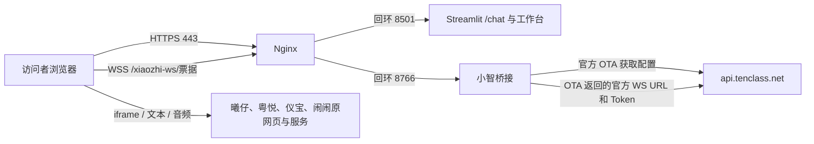

# 玩具 Agent 平台服务器部署与实时对话验收手册

当前工作台、发版自测与实时对话三个入口共用一次部署。部署前先看[统一部署方案](deployment_plan.md)，其中补充 `/release`、裁判环境变量、最新发布文件和自测验收清单；本文保留 Linux 安装和代理配置的详细命令。

> 核对日期：2026-10-29。依据当前源码和部署配置。
> 主方案：Debian 12（bookworm）+ Python 3.11 + systemd + Nginx + Let's Encrypt。
> 文中域名统一使用 `demo.example.com`，服务器 IP 使用 `SERVER_IP`，SSH 用户使用 `deploy`；请替换为实际值。
> 除明确标注的 Windows 上传命令外，命令均在 Linux 服务器执行。本文是部署说明，本次没有执行远端安装、域名修改或真实服务器上线。

## 1. 部署完成后的地址与连接结构

| 用途 | 地址 |
|---|---|
| 给老板演示 | `https://demo.example.com/chat` |
| 直接选择小智 | `https://demo.example.com/chat?toy=小智` |
| 原评测工作台 | `https://demo.example.com/` |
| 独立发版自测 | `https://demo.example.com/release` |
| 本机排查后端 | 服务器自身的 `http://127.0.0.1:8501/_stcore/health` |



服务器域名只作为本项目入口。小智上游继续请求 `https://api.tenclass.net/xiaozhi/ota/`，再连接当次响应的 WebSocket；不要把官方地址改成自己的域名，也不要把返回地址硬编码为某个历史路径。

其他四个玩具仍在浏览器中加载原 `lycheeai-muxi-test.pages.dev` 页面。**访问者电脑也必须能访问这些网页及其实际对话服务**，不能只检查服务器出网。

## 2. 开始前准备

准备以下信息与条件：

- 一台支持 systemd 的 Linux 服务器、可 sudo 的 SSH 账号，以及要使用的域名。
- DNS 控制权限；公网 80/443 入站可达，服务器可向外访问 DNS、HTTPS 和小智 WSS。
- 操作电脑有现代 Chrome/Edge、麦克风及扬声器；远程录音使用 HTTPS。
- 当前工作区的完整源码、锁定依赖和新增页面资源。

项目严格要求 Python `>=3.11,<3.12`。Debian 12 提供 Python 3.11；Ubuntu/Debian 其他版本不能仅因系统存在 `python3` 就直接使用。核对依据：[Debian Python 3.11 包信息](https://packages.debian.org/bookworm/python3.11)。

如果现有服务器不是 Debian 12：使用操作系统认可的方式另行安装 Python 3.11，再替换本文解释器安装步骤；不要修改系统默认 Python 链接或放宽项目版本约束。Windows Server 的 Linux 包、systemd 命令不适用，不能直接复制执行。

本方案为**单机、一个 Streamlit 实例、一个桥接端口**。小智沿用一个已绑定设备身份，有设备互斥；多位访问者不能同时占用它，实时对话与小智评测也应错开。多副本部署需要另外处理会话和桥接路由，不直接套用轮询负载均衡。

## 3. 安装系统软件和 Python

先确认系统：

```bash
cat /etc/os-release
uname -m
```

在 Debian 12 安装：

```bash
sudo apt update
sudo apt install -y python3.11 python3.11-venv nginx certbot python3-certbot-nginx ca-certificates curl openssl dnsutils rsync
python3.11 --version
nginx -v
certbot --version
```

Python 应显示 3.11.x。这里使用发行版提供的 Certbot 与 Nginx 插件，不混装 apt 和 snap 两套 Certbot。[Debian Nginx 插件包说明](https://packages.debian.org/bookworm/python3-certbot-nginx)。

在云控制台安全组开放 TCP 80/443。SSH 端口只向管理来源开放；如果启用了主机防火墙，同样放行当前 SSH 管理端口及 80/443。不要在未保留 SSH 规则时直接启用新防火墙策略。**8501 和 8766 不开放公网**，由 Nginx 访问服务器回环地址。

## 4. 上传当前项目，创建运行账户

当前新增路由、HTML、SVG、桥接及部署文件有未提交内容。只拉取旧 Git 提交可能缺文件，上传前须核对工作区；本地 Windows/macOS 虚拟环境不能直接复制到 Linux 使用。

Windows PowerShell 上传示例（在本地电脑执行）：

```powershell
$source = 'D:\Project\toy_agent-main\toy_agent-main'
$bundle = Join-Path $env:TEMP 'toy-agent-deploy.tar.gz'
tar.exe -czf $bundle --exclude=.git --exclude=.venv --exclude=.runtime --exclude=.triggers --exclude=.backups --exclude=__pycache__ --exclude=./reports --exclude=./.streamlit/secrets.toml -C $source .
tar.exe -tf $bundle
scp $bundle deploy@SERVER_IP:/tmp/toy-agent-deploy.tar.gz
```

`tar -tf` 核对包中至少包含下列文件，且没有 `.runtime/credentials`、旧报告或本机虚拟环境：

```text
streamlit_app.py / ui_styles.py / xiaozhi_chat.py / xiaozhi_connection.py
connection_scenes.py / execution_lock.py / dataset_thresholds.py
requirements.txt / scripts/check_environment.py
templates/xiaozhi_chat.html / templates/xiaozhi_logo.svg
deploy/nginx-chat.conf.example / deploy/toy-agent.service.example / deploy/toy-agent.env.example
tests/test_xiaozhi_chat.py / tests/test_live_chat_ui.py
.streamlit/config.toml / data/ / settings/ / toys/
```

在服务器首次创建专用非 root 账户与目录：

```bash
sudo useradd --system --user-group --create-home --home-dir /srv/toy-agent --shell /usr/sbin/nologin toyagent
sudo install -d -o toyagent -g toyagent /srv/toy-agent/app
sudo tar --no-same-owner -xzf /tmp/toy-agent-deploy.tar.gz -C /srv/toy-agent/app
sudo chown -R toyagent:toyagent /srv/toy-agent/app
```

已有同名账户或部署目录时先检查用途，不能直接覆盖生产目录。以上解包是首次部署；更新与回滚见第 14 节。

## 5. 创建虚拟环境、安装依赖、离线检查

```bash
sudo -u toyagent python3.11 -m venv /srv/toy-agent/app/.venv
sudo -u toyagent /srv/toy-agent/app/.venv/bin/python -m pip install -r /srv/toy-agent/app/requirements.txt
cd /srv/toy-agent/app
sudo -u toyagent .venv/bin/python scripts/check_environment.py
sudo -u toyagent .venv/bin/python -m pip check
sudo -u toyagent .venv/bin/python -m unittest discover -s tests -p test_xiaozhi_chat.py -v
sudo -u toyagent .venv/bin/python -m unittest discover -s tests -p test_live_chat_ui.py -v
```

预期：环境锁定检查通过，pip check 无冲突，桥接和 UI 专项测试通过。它们使用本机协议服务或测试替身，不会点击真实服务唤醒或发送消息。若服务器策略禁止本机监听，需先按正常权限配置处理；不要删断言或把错误跳过。

安装失败先核对 Python 系列、包源可达性、CPU 架构和系统时间。不要通过单独升级 Streamlit、全局安装包或使用 `--break-system-packages` 解决。

本节不是完整评测环境验收。Windows DPAPI 凭据只适用于原 Windows 用户，复制到 Linux 不能解密；即使复制 `toy.json` 的 `local:…` 引用也不能复用。**只演示实时对话不需要 Qwen/DeepSeek Key 或公司玩具的本机 DPAPI**。若还要在服务器执行原评测，应另行将对应档案凭据配置为服务器环境变量引用；Linux 页面不支持直接 DPAPI 保存。存在旧引用时全量测试/真实评测可能因此失败，需与对话入口验证区分。

## 6. 配置域名解析

在域名服务商新增：

| 记录类型 | 名称示例 | 记录值 |
|---|---|---|
| A | `demo` | 服务器公网 IPv4 |
| AAAA | `demo` | 仅在实际配置且可访问 IPv6 时填写 |

检查：

```bash
dig +short A demo.example.com
dig +short AAAA demo.example.com
```

确认解析指向本台服务器。错误 AAAA 可能让浏览器或证书验证走到不可达地址；没有 IPv6 服务就不要保留该记录。首轮建议先使用直接 DNS 解析完成源站验收，再单独接入 CDN/其他代理，避免同时排查多层代理。

## 7. 配置公共来源和 systemd 服务

安装项目提供的环境示例：

```bash
cd /srv/toy-agent/app
sudo install -m 600 deploy/toy-agent.env.example /etc/toy-agent.env
sudoedit /etc/toy-agent.env
```

内容如下，将两个域名位置改为实际域名，值中不要加 `export`：

```ini
XIAOZHI_CHAT_PUBLIC_ORIGIN=https://demo.example.com
XIAOZHI_CHAT_PORT=8766
STREAMLIT_BROWSER_SERVER_ADDRESS=demo.example.com
STREAMLIT_BROWSER_SERVER_PORT=443
STREAMLIT_SERVER_ENABLE_CORS=true
STREAMLIT_SERVER_ENABLE_XSRF_PROTECTION=true
```

公共来源必须与浏览器实际使用的协议、主机和非默认端口一致，不含 `/chat` 或其他路径。不要填官方 OTA 域名。端口 8766 与 Nginx 桥接目标保持一致，不要在服务器模式使用随机端口 0。

安装、检查并启动 systemd 单元：

```bash
sudo install -m 644 deploy/toy-agent.service.example /etc/systemd/system/toy-agent.service
sudo systemd-analyze verify /etc/systemd/system/toy-agent.service
sudo systemctl daemon-reload
sudo systemctl enable --now toy-agent.service
sudo systemctl status toy-agent.service --no-pager
curl -fsS http://127.0.0.1:8501/_stcore/health
```

健康接口应返回 `ok`。服务使用专用账户、项目 `.venv`、固定工作目录和文件环境变量；终端退出后继续运行，开机自动启动，异常退出自动重启。没有启动评测触发器或企业微信通知。

项目/全局配置可被环境变量及命令行覆盖，相关说明见 [Streamlit 配置文档](https://docs.streamlit.io/develop/api-reference/configuration/config.toml)。保持 CORS/XSRF 开启，反向代理问题应核对实际域名、端口和升级头，不把永久关闭保护作为部署方案。

**此时可能只看到 8501 监听，属于正常情况。** 桥接 8766 在首次打开“小智”页时才启动；打开页面本身不发官方 OTA，点击“唤醒”才发。不要把尚未打开小智时的 8766 未监听误判为服务失败。

## 8. 配置 Nginx HTTP 入口

先用 HTTP 配置建立域名入口，再让 Certbot 安装证书。已有其他站点时使用独立站点文件，不覆盖其他域名配置。

```bash
sudo install -m 644 /srv/toy-agent/app/deploy/nginx-chat.conf.example /etc/nginx/snippets/toy-agent-chat.conf
sudo tee /etc/nginx/sites-available/toy-agent > /dev/null <<'NGINX'
server {
    listen 80;
    server_name demo.example.com;
    client_max_body_size 20m;

    include /etc/nginx/snippets/toy-agent-chat.conf;
}
NGINX
sudoedit /etc/nginx/sites-available/toy-agent
sudo ln -s /etc/nginx/sites-available/toy-agent /etc/nginx/sites-enabled/toy-agent
sudo nginx -t
sudo systemctl reload nginx
```

`sudoedit` 时替换实际域名。首次创建软链接；若链接已存在，先核对目标，不重复创建或删除其他站点。

检查域名 HTTP：

```bash
curl -I http://demo.example.com/chat
```

预期收到页面响应，不能是连接超时或 502。此阶段只验证网站到后端，不验收录音；小智公共桥接已配置 HTTPS，需完成下一节后才能完整使用。

### 反向代理的关键内容

项目 Nginx 示例已包含两条路由：

| 路由 | 转发目标 | 作用 |
|---|---|---|
| `/` | `http://127.0.0.1:8501` | 页面、资源、Streamlit WebSocket |
| `/xiaozhi-ws/` | `http://127.0.0.1:8766/` | 小智浏览器桥接 |

两个路由均显式转发 Upgrade/Connection，使用 HTTP/1.1 和长连接超时。桥接的 `proxy_pass` 尾部 `/` 必须保留，它将 `/xiaozhi-ws/<ticket>` 改写为 `/<ticket>`，与后端校验匹配；Origin 保留浏览器原值，不能改写成 localhost。桥接访问日志关闭以避免记录路径票据。[Nginx 官方 WebSocket 代理说明](https://nginx.org/en/docs/http/websocket.html)。

不要把路由改为指向 `api.tenclass.net`：本项目服务器会负责请求官方 OTA、提取 Token 并与官方 WS 握手；Nginx 只连接本项目的本机桥接。

## 9. 申请 HTTPS 证书与自动续期

先确认：域名解析正确、外部 80 可达、`nginx -t` 通过、没有其他服务抢占 80/443。然后运行：

```bash
sudo certbot --nginx -d demo.example.com --redirect
sudo nginx -t
sudo systemctl reload nginx
sudo certbot certificates
sudo systemctl enable --now certbot.timer
sudo systemctl status certbot.timer --no-pager
sudo certbot renew --dry-run
```

按交互提示填写实际邮箱并同意条款。Certbot 安装成功后检查 HTTPS 与跳转：

```bash
curl -I http://demo.example.com/chat
curl -I https://demo.example.com/chat
curl -fsS https://demo.example.com/_stcore/health
```

预期：HTTP 跳转 HTTPS；HTTPS 能加载页面；健康接口返回 `ok`。保留有效证书及续期所需的验证入口，避免后续 DNS/代理修改使验证不可达。执行 dry-run 验证续期流程，参见 [Certbot 证书与续期文档](https://eff-certbot.readthedocs.io/en/stable/using.html#renewing-certificates)。

录音需要安全上下文及浏览器授权，HTTP 公网 IP 页面不作为语音验收入口；参见 [MDN getUserMedia](https://developer.mozilla.org/en-US/docs/Web/API/MediaDevices/getUserMedia)。若另有统一安全响应头，不要设置 `Permissions-Policy: microphone=()` 或禁止外部玩具 iframe 的麦克风权限，也不要未经验证加上会阻止这些 iframe、音频或脚本的 CSP。

## 10. 上线前基础验证

### 10.1 服务器侧

```bash
sudo systemctl is-active toy-agent.service nginx
sudo ss -lntp | grep -E ':80\b|:443\b|:8501\b|:8766\b'
sudo journalctl -u toy-agent.service -n 80 --no-pager
```

80/443 对外监听；8501/8766 只在 127.0.0.1 监听。8766 需先打开一次小智页面后再检查。日志应无 Python 导入失败、缺文件、端口占用或持续重启。

仅验证官方 OTA 域名的 TLS/网络可达性（不发 POST、不激活设备）：

```bash
curl --connect-timeout 10 --max-time 20 -sS -o /dev/null -w 'HTTP %{http_code}\n' https://api.tenclass.net/xiaozhi/ota/
```

GET 返回 401/403/405 等非 2xx 不足以证明 OTA POST 不可用；此处先看有无 DNS/TLS/连接错误。真正的 OTA 成功要用下一节的页面唤醒验证。不要把完整 OTA 响应、Token 或票据贴到群里排查。

### 10.2 访问者电脑

通过实际域名访问 `/chat`，应只显示五个玩具切换和对话区域，不能卡在加载状态。打开 `/` 应仍能看到原工作台，原菜单仍可操作。再刷新一个指定玩具的地址，确认选择保留。

窗口缩小后输入栏仍可见；长聊天记录在聊天区滚动。首次打开页面不应自动唤醒。其他四个玩具原网页的连通性必须从这台访问者电脑验证。

## 11. 小智实时对话验收

在浏览器实际 HTTPS 域名中执行：

1. 打开 `/chat?toy=小智`，确认小智 Logo、欢迎头像正确，初始为“未连接”。
2. F12 → Network → WS，点击页面“唤醒”。除 Streamlit 的 `/_stcore/stream` 外，应出现 `wss://demo.example.com/xiaozhi-ws/<ticket>`，握手状态 101。
3. 页面最终变成“已连接”、文本框可输入。在 WS Messages 中确认收到含 session_id 的 hello，而不只看 UI 标签。
4. 发送一次“你好”，确认用户消息和真实助手文本出现，不重复、不显示公司玩具回答。
5. 点击“开始收音”，允许浏览器麦克风授权，说一两秒清楚的话，再按页面交互停止。确认有录音状态变化、识别文本和回答；检查接收的音频是否实际播放，扬声器和系统音量未静音。
6. WS 消息应有文本帧及双向二进制音频帧。看到二进制帧只证明数据传输，最终仍要人工确认收音和播放正确。
7. 点击唤醒/断开控件结束连接，再重新唤醒应可建立新会话；切换到另一个玩具后，应关闭小智 WS、停止录音，麦克风占用状态随之释放。
8. 刷新页面保留小智选择，初始不应自动发送 OTA 或自动重连。不要同时在工作台运行同身份的小智评测。

**为什么 F12 没有官方 OTA 请求？** 这是正常的：OTA 和官方 WS 请求发生在服务器 Python 中。F12 显示浏览器到本项目的桥接连接，不显示服务器到小智官方的连接。桥接 101 只代表第一段升级成功；收到上游 hello 且有真实回答，才说明后续官方链路也成功。

## 12. 其他四个玩具验收

逐个选择，先核对当前 iframe 地址里的参数，避免菜单串接：

| 菜单 | MAC 参数 | productName 解码值 |
|---|---|---|
| 曦仔 | `02:00:00:00:00:0b` | 曦仔 |
| 粤悦 | `02:00:00:00:00:0c` | 广电-粤悦 |
| 仪宝 | `02:00:00:00:00:0f` | 仪电-仪宝 |
| 闹闹 | `02:00:00:00:00:13` | 菲菲特-闹闹 |

每个玩具依次完成：页面名称/头像加载 → 点击唤醒 → 一条文本有回复 → 录音有识别与回答 → 实际播放声音 → 断开/切换释放连接。短暂加载默认头像或名称时，等待初始化完成再判定。

这些页面的 OTA/WS 由原网页及其服务实现，通常在 F12 中能看到相应的外部请求；它们**不应被改成小智官方 OTA，也不走 `/xiaozhi-ws/`**。iframe 加载出来不等于对话服务已连通，必须逐个完成真实文本/语音检查。

如果页面正常但麦克风被拒绝，检查地址栏网站权限和系统麦克风权限，同时检查嵌入网页的授权提示；不要只给顶层站点授权后就认为 iframe 已获权限。

## 13. 常见故障与定位

| 现象 | 优先检查 |
|---|---|
| 域名打不开 | A/AAAA、云安全组、主机防火墙、Nginx 服务与 80/443 监听 |
| 证书申请失败 | 公网 80、错误 AAAA、解析未生效、已有代理/CAA 限制；先读 Certbot 错误 |
| Nginx 502 | `toy-agent.service`、8501 是否监听、WorkingDirectory、Python/依赖/文件权限 |
| 页面长期加载/Streamlit WS 失败 | `/` 路由 Upgrade/Connection、域名/端口配置、代理超时；保持 CORS/XSRF 开启 |
| 小智 WS 地址仍为 127.0.0.1 | systemd 环境文件是否配置、是否重启服务、页面是否刷新；浏览器旧会话不代表新配置 |
| 小智 `/xiaozhi-ws/` 返回 502 | 先打开小智页，再看 8766；检查端口占用、变量和 Nginx 目标端口一致 |
| 小智 WS 立即 1008 关闭 | 真实 Origin 与 PUBLIC_ORIGIN 是否一致，代理有没有保留 Origin、剥离前缀；不要强改 Origin 绕过 |
| 小智 101 后又断开 | 101 仅代表桥接；检查官方出网、设备激活、hello 是否到达、设备是否被另一会话/评测占用 |
| 重启后旧页连接失败 | 票据随桥接进程改变，刷新页面生成新地址；不要保存或手工拼接旧票据 |
| 录音按钮无权限/无效 | HTTPS、安全上下文、系统/浏览器麦克风授权、Permissions-Policy、iframe 权限 |
| 有文本但没声音 | 浏览器播放权限、系统音量/输出设备、Opus 音频包是否收到；实际用扬声器验收 |
| 其他玩具连不上 | 访问者网络到原页面/实际服务的可达性、原服务绑定状态；不是只检查本项目桥接 |
| 首页档案可见但评测凭据报错 | Windows local/DPAPI 引用未迁移，Linux 需使用适配后的环境变量引用 |

常用诊断命令：

```bash
sudo nginx -t
sudo journalctl -u toy-agent.service -n 100 --no-pager
sudo tail -n 100 /var/log/nginx/error.log
sudo systemctl status toy-agent.service nginx --no-pager
```

只提供与故障相关、已脱敏的日志；不要公开完整票据、官方 Token、API Key、Webhook 或完整未处理网络抓包。

## 14. 日常更新、重启与回滚

服务端关闭文件监听，上传代码不会自动触发重载；修改代码/环境变量后需明确重启。

```bash
sudo systemctl restart toy-agent.service
sudo systemctl status toy-agent.service --no-pager
curl -fsS http://127.0.0.1:8501/_stcore/health
```

更新前等待评测和对话结束。备份当前代码版本、`data/`、`settings/`、`toys/`、`reports/`、运行所需配置和 Nginx 环境文件，备份按敏感资料保管。部署包仍不得包含未经处理的本机凭据。

更新步骤：先在独立目录解包并检查版本和依赖 → 维护窗口停止服务 → 将必要代码及对应锁文件更新到部署目录 → 若依赖变动，在服务虚拟环境按锁文件安装 → 启动服务 → 检查健康 → 逐个验证五个玩具。不要用全目录覆盖命令顺手删除正式资产或报告。

失败时恢复上一套**匹配的代码、依赖锁文件和必要配置**，再重启验收。代码回滚不自动意味着业务数据已回滚，不要用旧 Excel/报告覆盖期间产生的新数据。修改 Nginx 后先 `nginx -t`，通过后才 reload。

重启会断开现有对话、替换桥接票据；用户需刷新页面并重新唤醒。HTTPS/Nginx reload 与应用 restart 的影响不同，不能拿“服务显示 active”代替对话验收。

## 15. 交付验收记录

由部署人员填写真实结果；以下默认均为待验收，不是本次执行结论。

| 验收项 | 状态/证据 |
|---|---|
| 域名 A/AAAA 与公网入口正确 | 待填写 |
| HTTPS、HTTP 跳转、证书续期 dry-run 成功 | 待填写 |
| systemd 开机启动、健康接口正常 | 待填写 |
| 8501/8766 回环监听、仅一个实例 | 待填写 |
| `/chat` 五玩具切换、刷新保留、布局正常 | 待填写 |
| 小智 bridge 101 + 官方 hello + 文本正常 | 待填写 |
| 小智真实收音、识别、音频播放、断开释放 | 待填写 |
| 曦仔文本与真实语音 | 待填写 |
| 粤悦文本与真实语音 | 待填写 |
| 仪宝文本与真实语音 | 待填写 |
| 闹闹文本与真实语音 | 待填写 |
| 原工作台菜单正常；凭据如需评测已单独迁移 | 待填写 |
| 更新回滚路径及配置备份已确认 | 待填写 |

测试时间、浏览器版本、目标域名、测试者及异常证据另行记录。当前源码的本地测试证明不了目标服务器证书、真实用户麦克风或外部服务可用性。

相关资料：[桥接部署原理](xiaozhi_chat_deployment.md)、[Nginx 配置示例](../deploy/nginx-chat.conf.example)、[systemd 服务示例](../deploy/toy-agent.service.example)、[环境变量示例](../deploy/toy-agent.env.example)。
